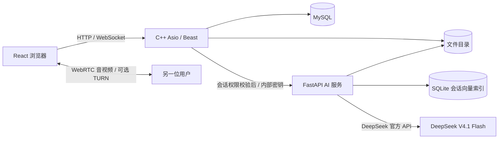

# 青聊 · C++ 智能即时通信

Windows 原生运行的类微信一对一聊天应用：C++17 + Boost.Asio / Beast、MySQL、React、FastAPI、WebRTC，带 RAG 资料问答和工具型 Agent。**本机已编译、启动并完成真实双账号验收，不需要 Linux 或 Docker。**

## 现在怎么用

```powershell
# VS Code 或 PowerShell 打开项目根目录
powershell -ExecutionPolicy Bypass -File scripts/start-windows.ps1
```

打开 http://localhost:8080 。普通窗口注册用户 A，无痕窗口注册用户 B；从通讯录选择对方即可聊天。语音 / 视频来电会全局弹出，不要求对方正在查看同一个聊天。

**AI 配置：在根目录 `.env` 的 `DEEPSEEK_API_KEY=` 填入 DeepSeek 官方商用 API 密钥。Windows AI 服务每次请求读取最新模型配置，无需因修改密钥重启聊天或公网隧道。不要将密钥发到聊天里，不要提交 `.env`。** 配置和密钥仅在后端；C++ 本身不自动读取 `.env`。旧的 `LLM_API_KEY` 仅保留兼容入口，迁移时已清空旧网关密钥。

```powershell
powershell -ExecutionPolicy Bypass -File scripts/stop-windows.ps1
powershell -ExecutionPolicy Bypass -File scripts/start-windows.ps1
```

VS Code 里可直接“终端 → 运行任务 → 青聊：启动所有服务”。VS / VS Code 调试、第一次安装、目录及端口说明见 [Windows 使用说明](docs/windows.md)。

新版详细边界与验收说明见 [第二版说明](docs/upgrade-v2.md)。

## 功能

| 模块 | 当前实现 |
| --- | --- |
| 账号与联系人 | 注册、登录、退出、好友申请与处理、修改密码、单聊与最多 50 人群聊 |
| 文字聊天 | 表情、两分钟内撤回及同步、发送状态、失败重试、持久化、去重、排序、历史分页、断线补拉 |
| 会话列表 | 最后消息预览、本地时间、未读计数、阅读游标 |
| 文件 | 任意附件最大 1 GB、4 MB 分片、SHA-256、暂停/续传、流式下载、共享文件及鉴权 |
| 图片 | PNG / JPG / GIF / WebP、粘贴发送、聊天缩略图、放大预览 |
| 视频文件 | MP4 / WebM / MOV 文件发送，浏览器支持的编码可直接播放；支持 HTTP 字节范围下载 |
| 语音消息 | 浏览器录音、取消、最长 60 秒、发送后播放 |
| 语音 / 视频通话 | WebRTC 一对一、来电、接听、拒绝、取消、忙线、静音、摄像头开关、挂断、通话记录、超时回收 |
| RAG | 本地 384 维语义向量 + 词法混合检索、会话隔离、引用编号与证据核验、无依据说明 |
| 文件索引 | TXT / MD / CSV / LOG / DOCX / PDF，图片 OCR、扫描 PDF OCR，异步解析和重建 |
| 摘要 | 按 UTC 时间范围，最多 2000 条聊天，分段后汇总 |
| Agent | 真正的模型 function calling 循环，四个工具、只读权限、次数和超时限制、执行记录 |

Agent 工具：`search_conversation`、`summarize_file`、`summarize_chat`、`generate_travel_plan`。例如：“总结大家的出行时间和预算，结合攻略生成两天行程草案。”行程工具使用会话资料与模型生成建议，不查询实时票价、不执行预订、不冒充外部 travel-agent 服务。

## 已验证与边界

2026-10-28，在本机 Windows 上实际完成：

- VS 2022 MSVC x64 编译和链接 C++ 服务；真实 MySQL / C++ / Python / React 联调。
- 真实双账号文字、图片放大、文件字节一致性、跨会话拒绝、录音消息、视频文件解码播放。
- 真实浏览器 WebRTC 语音 / 视频连接，收到对方视频帧，静音、挂断和拒接；测试使用虚拟摄像头 / 麦克风，没有读取本人的真实设备。
- 真实 API 的消息去重、并发排序、历史补拉、WebSocket、未读、搜索、Range、忙线和角色权限检查。
- 24 项 Python 测试、真实社交/续传浏览器验收、26 题项目资料语义检索评估。
- 完整 C++ → MySQL → Python 索引 → RAG / 摘要 / Agent 工具 → 持久化任务验收，模型使用独立本地模拟端点，不改主应用配置。

**真实 DeepSeek 官方 Agent 调用已通过：使用合成资料执行 search_conversation，经过两次模型请求返回正确答案和引用。跨运营商公网通话尚需 HTTPS / WSS 和可用 TURN 服务。** 检索现使用本地量化多语言 MiniLM 384 维语义向量和词法分数混合排序。26 题项目资料集 Recall@6 为 95.45%，仍保留失败案例；该小样本结果不等于通用问答准确率。

当前是浏览器界面 + Windows 原生后端的含单聊与群聊的应用，不是微信全部产品功能的复刻；没有朋友圈、支付、移动端安装包、端到端消息加密、语音转写 / 视频内容理解或任意格式转码。媒体能否播放取决于浏览器支持的编码。

详细结果见 [验收记录](docs/validation.md)。截图在 `docs/screenshots/windows-real-*.png`，其中账号及内容是自动化测试数据。日志在 `data/logs`。

## 架构



Windows 开发入口由 Vite 代理到 C++，C++ 使用 Asio 的 Windows 后端；Linux 下 Asio 使用 epoll。没有声称手写 epoll。媒体不经 C++ 服务器搬运，C++ 负责已鉴权的通话状态和信令。

官方接口：`POST https://api.deepseek.com/chat/completions`，`Authorization: Bearer <DEEPSEEK_API_KEY>`，`Content-Type: application/json`。模型 ID 为 `deepseek-flash`，对应官方 DeepSeek-V4.1-Flash；输入简写 `dsv4.1flash` 会规范为该 ID。请求使用 `thinking:{"type":"disabled"}`、`stream:false`，解析 `choices[0].message.content`；不再发送 Qwen 的 `enable_thinking`。Agent 同接口使用标准 `tools` / `tool_choice` 及 `tool_call_id` 回传工具结果。问答温度 0.2。当前显示任务结果，不实现逐 token SSE 流式输出。

配置示例：

```dotenv
DEEPSEEK_API_KEY=在此填写你的DeepSeek官方密钥
LLM_BASE_URL=https://api.deepseek.com
LLM_MODEL=deepseek-flash
```

官方模型及请求说明：https://api-docs.deepseek.com/quick_start/agent_integrations/ 。接口 401 / 402 / 400 / 429 分别提示密钥、余额、参数和频率问题，不自动重试产生费用的请求。

## 代码与检查

```powershell
.\.venv\Scripts\python.exe -m pytest tests -q
.\.venv\Scripts\python.exe scripts/smoke.py
.\.venv\Scripts\python.exe scripts/feature-smoke.py
.\.venv\Scripts\python.exe scripts/ws_smoke.py
node scripts/e2e.cjs
.\.venv\Scripts\python.exe scripts/ai-stack-test.py
.\.venv\Scripts\python.exe scripts/evaluate.py
.\.venv\Scripts\python.exe scripts/product-smoke.py
node scripts/product-e2e.cjs
.\.venv\Scripts\python.exe scripts/evaluate-rag-v2.py
```

这些接口和浏览器脚本会创建测试账号、消息和附件。清理工具默认只预览，以精确的测试账号名称格式识别数据：`python scripts/cleanup_test_data.py`；显式加 `--apply` 才删除测试数据。普通账号不受影响。

| 路径 | 内容 |
| --- | --- |
| `server/main.cpp` | C++ 网络、鉴权、消息、文件、AI 任务代理 |
| `server/features.hpp` | 通话状态、信令、ICE 配置、搜索、未读、Range |
| `ai/app.py` / `ai/agent_tools.py` | RAG、索引、摘要、Agent 工具循环 |
| `web/App.jsx` / `web/useCall.jsx` | 类微信聊天界面、WebRTC 通话 |
| `web/MediaMessage.jsx` / `web/AIPanel.jsx` | 媒体消息和 AI 面板 |
| `scripts/` / `.vscode/` | 原生启动、构建、调试和自动验收 |

本地连接上限 512、业务线程 8、已提交任务上限 128；HTTP 请求体最大 50 MB。新界面每次传输 4 MB 分片，最大 1 GB；下载每连接使用 128 KB 缓冲区。Chrome/Edge 本地文件保存支持暂停和继续下载，不支持该接口的浏览器回退普通下载。旧的单次上传兼容接口仍限制 50 MB。不宣称能承受大规模并发。Python 最多 32 个排队任务、同时运行 2 个；任务状态和索引持久化，重启时中断任务标为失败。RAG 单会话最多 10000 片段；问答使用最近 200 条聊天。

## 临时分享给外网朋友

双击 `Start-Sharing.cmd` 可启动带分享口令的 Cloudflare 临时 HTTPS 链接；双击 `Stop-Sharing.cmd` 关闭公网访问。电脑和本地应用需要保持运行。真实公网 HTTPS、浏览器口令登录、API 和 WSS 消息已验证；详见 [公网分享说明](docs/sharing.md)。跨网音视频仍需可用 TURN，中继不由 HTTP 隧道替代。

## 可选 Docker 部署

Docker 只是另一种部署方式：`docker compose up --build -d`。本机并未运行 Docker；实际验收走 Windows 原生方式。不要执行 `docker compose down -v`，除非确实要删除该部署的全部数据卷。
